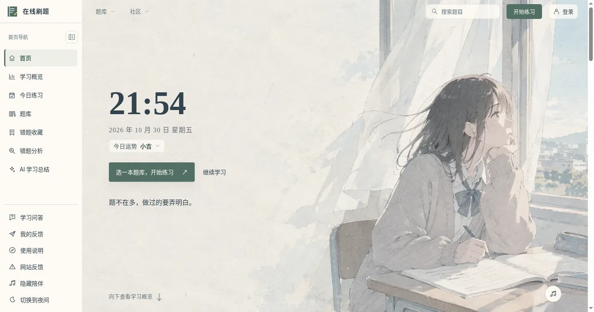
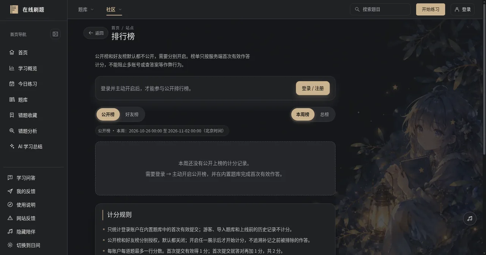
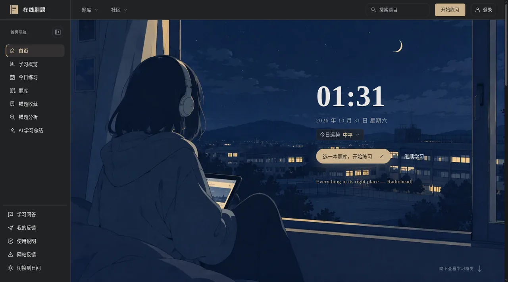

# Still Floating · 刷题站定制层


> **这是一个 Vibe Coding 项目。** 从想法、文案到补丁代码，主要由 AI 结对生成，人类负责方向、审美和验收。代码公开存档，供学习、参考和二次创作。
>
> 在线站点：<https://quiz.stillfloating.top>




## 背景

刷题站本体（React 前端 + Node 服务）部署时只有构建产物，源码没有随包提供。所以这个仓库公开的不是站点本体，而是**部署后加上的定制层**：主题启动脚本、视觉统一层，以及直接对构建产物打补丁的脚本。

换句话说：本站的「Vibe Coding」痕迹主要在这里——用 AI 生成一层外部 CSS/JS 和 Python 补丁，在不动原始构建的前提下改界面、改文案、换图标。

## 内容

```
theme-init.js          # 首帧前定主题，避免夜间模式闪白（CSP 要求同源外部脚本）
ui-polish.css          # 视觉统一层：卡片可读性、圆角、间距、夜间配色
ui-polish.js           # 渲染后微调：精简「使用说明」、修正侧栏跳转等
scripts/
├── patch-icons.py     # 给侧栏每个功能补上不同图标（直接改构建产物）
├── patch-copy.py      # 用预先选好的歌词替换首页轮换语和运势签语
├── deploy.sh          # 图标/文案补丁的部署脚本（备份 → 拉取 → 打补丁 → 上传 → 校验）
└── deploy-ui.sh       # 视觉层部署脚本
screenshots/
```



## 本地试用与部署

`patch-icons.py` 和 `patch-copy.py` 都接受输入、输出两个文件路径。可以先在站点 bundle 的副本上运行补丁，再检查差异：

```bash
python3 scripts/patch-icons.py input.js icons.js
python3 scripts/patch-copy.py icons.js patched.js
```

这两个补丁识别特定的代码片段，适用的输入取决于构建版本。站点更新后先核对 bundle 名称和补丁锚点。`patch-copy.py` 直接使用脚本中预先选好的歌词，运行时无需请求博客接口。

`scripts/deploy-ui.sh` 部署样式和交互层，`scripts/deploy.sh` 部署图标和文案补丁。两者会通过 SSH 修改目标站点文件。使用前请核对目标主机、远端路径、文件属主、站点响应校验和资源版本号，先在测试环境验证。

## 许可

仓库代码以 [MIT](LICENSE) 许可开源。站点本体、题库与第三方资源遵循各自许可。

## 2026-11-18 公开版更新

保留主题、样式、交互脚本和构建产物补丁，补充公开范围与维护路线。使用脚本前需要准备匹配的站点构建产物。 [查看更新提交](https://github.com/zts8989898937-coder/stillfloating-quiz/commit/19b2aa511bb0b491f0b8db1add66ec0cb0c124f2)

[公开范围](PUBLIC_SCOPE.md) · [架构说明](docs/ARCHITECTURE.md) · [后续路线](docs/ROADMAP.md)
