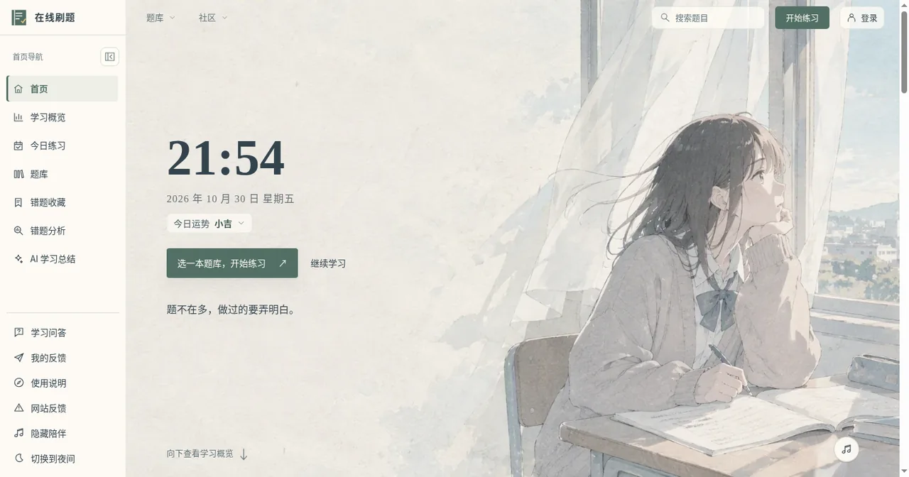
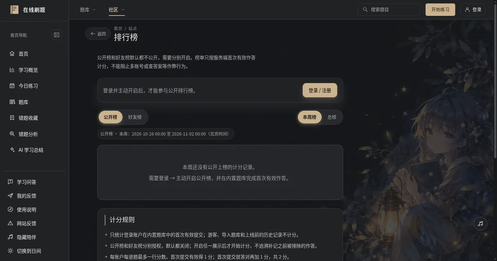
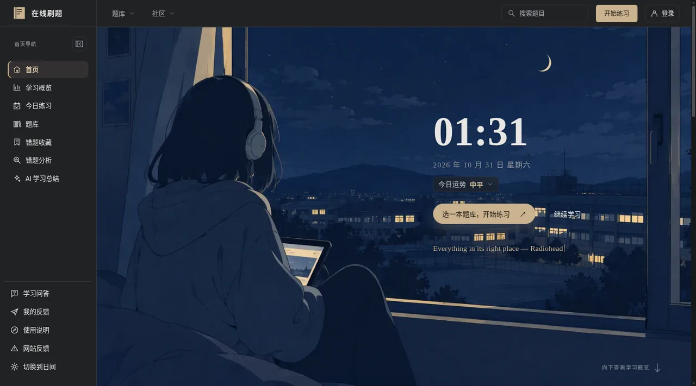

# Still Floating · 刷题站定制层


> **这是一个 Vibe Coding 项目。** 从想法、文案到补丁代码，主要由 AI 结对生成，人类负责方向、审美和验收。代码公开存档，供学习、参考和二次创作。
>
> 在线站点：<https://quiz.stillfloating.top>




## 背景

刷题站本体（React 前端 + Node 服务）部署时只有构建产物，源码没有随包提供。所以这个仓库公开的不是站点本体，而是**部署后加上的定制层**：主题启动脚本、视觉统一层，以及直接对构建产物打补丁的脚本。

换句话说：本站的「Vibe Coding」痕迹主要在这里——用 AI 生成一层外部 CSS/JS 和 Python 补丁，在不动原始构建的前提下改界面、改文案、换图标。

## 内容

```
theme-init.js          # 首帧前定主题，避免夜间模式闪白（CSP 要求同源外部脚本）
ui-polish.css          # 视觉统一层：卡片可读性、圆角、间距、夜间配色
ui-polish.js           # 渲染后微调：精简「使用说明」、修正侧栏跳转等
scripts/
├── patch-icons.py     # 给侧栏每个功能补上不同图标（直接改构建产物）
├── patch-copy.py      # 用博客歌词接口替换首页轮换文案与教练式文案
├── deploy.sh          # 图标/文案补丁的部署脚本（备份 → 拉取 → 打补丁 → 上传 → 校验）
└── deploy-ui.sh       # 视觉层部署脚本
screenshots/
```



## 怎么用

这些脚本针对线上服务器的构建产物工作，默认通过 `ssh hk` 连接、路径为 `/srv/quiz-site/current/dist/web`：

```bash
# 视觉层（CSS/JS/主题启动脚本）
./scripts/deploy-ui.sh

# 图标 + 文案补丁
./scripts/deploy.sh
```

脚本会先备份原文件到 `/root/site-backup/`，再上传并做 HTTP 校验。

## 注意

- 补丁脚本绑定了具体的 bundle 文件名（如 `index-D2YsLB2t.js`）。站点升级后哈希会变，需要更新脚本里的 `ASSET_MAIN` / `ASSET_CHUNK`。
- `patch-copy.py` 会请求博客的歌词接口（`https://stillfloating.top/wp-json/stillfloating/v1/lyrics`），博客侧不可用时跳过替换。
- 脚本含服务器路径，只适合作者本人环境使用；公开仅为存档参考。

## 许可

代码以 [MIT](LICENSE) 许可开源。站点本体、题库与第三方资源遵循各自许可。
